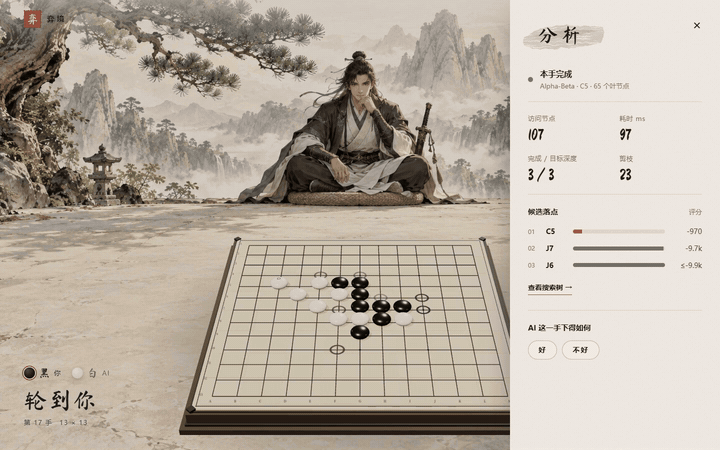
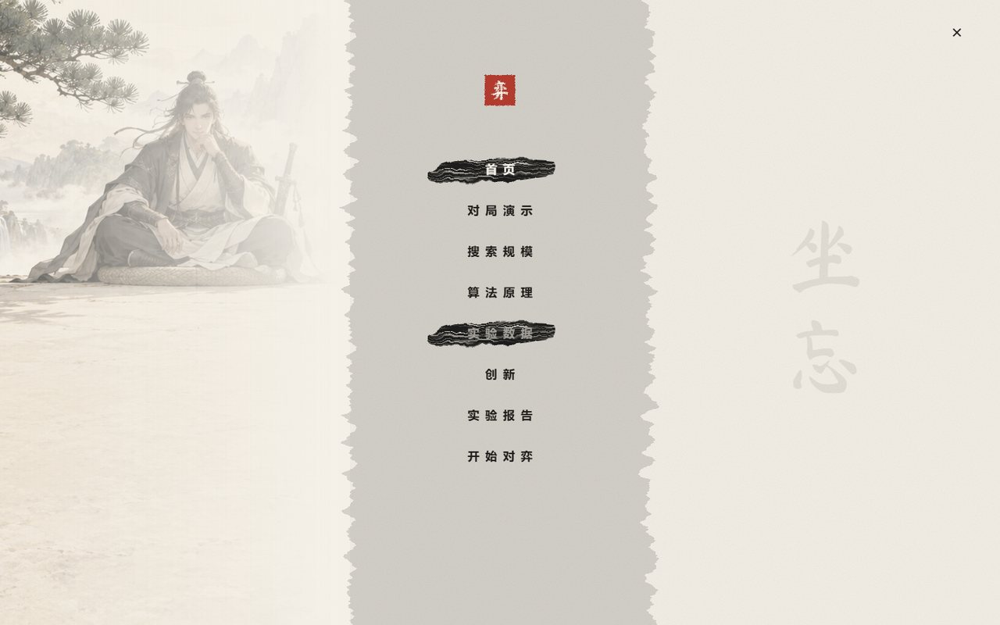
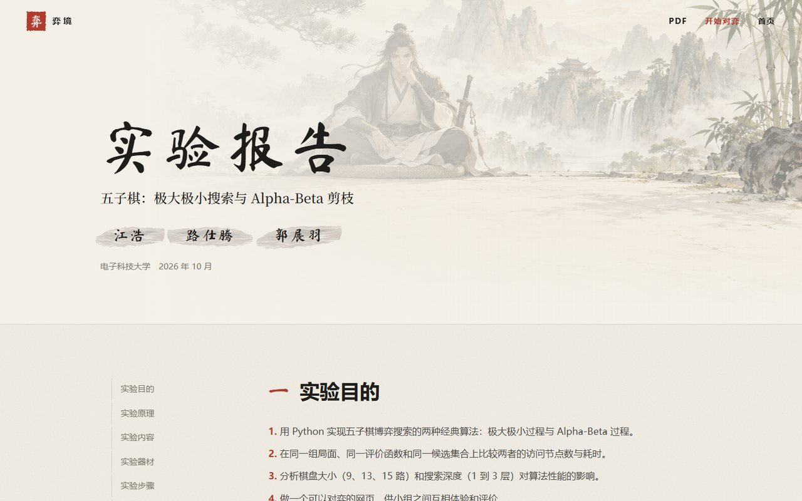
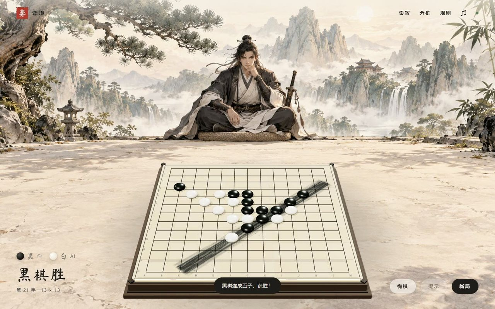
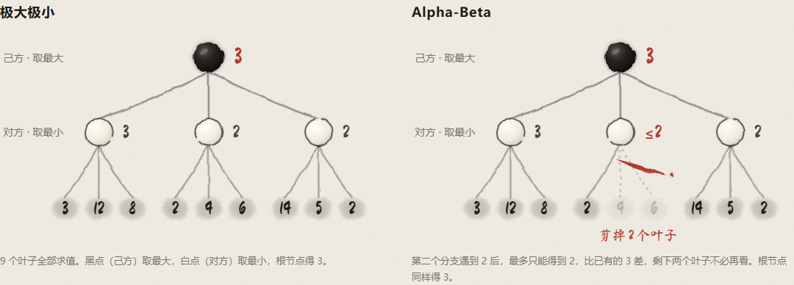
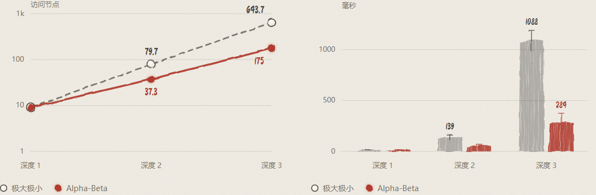

<div align="center">


# 身入弈，坐忘境

**五子棋 · 极大极小搜索与 Alpha-Beta 剪枝**

电子科技大学 人工智能 实验一　｜　江浩 · 路仕腾 · 郭展羽

[在线对弈](https://haoceanlab.cn/gomoku/game.html) · [项目主页](https://haoceanlab.cn/gomoku/) · [网页版报告](https://haoceanlab.cn/gomoku/report.html) · [PDF 报告](docs/实验一五子棋实验报告.pdf) · [GitHub Pages 镜像](https://haohaha-11.github.io/gomoku-lab/)

</div>

---

用 Python 实现五子棋的两种经典博弈搜索：极大极小过程与 Alpha-Beta 过程。两者共用同一个评价函数和候选生成，在 9 / 13 / 15 路棋盘、深度 1 到 3 层下做了 162 次对照测量；再把引擎接到一个水墨风格的 3D 对弈网页上，供各组互相体验。

## 预览



| 目录 | 网页版报告 | 对弈 |
|---|---|---|
|  |  |  |

完整录像（42 秒，实时录制）：[web/media/gomoku-demo.mp4](web/media/gomoku-demo.mp4)

## 功能

- **对弈**：人机或双人；可切换极大极小 / Alpha-Beta、搜索深度 1–5 层、棋盘 9 / 13 / 15 路；支持悔棋、提示、手数、候选落点标记、棋谱导出。
- **看得见的搜索**：每一手显示访问节点、耗时、完成深度、剪枝次数和前三个候选；可以展开本次搜索的博弈树与主变化线。
- **人类反馈**：在「分析」里评价 AI 的上一手，记录存入服务器的 SQLite，供后续偏好学习使用。
- **展示页**：项目主页、网页版报告、数据图表与录像，宣纸、浓墨、朱砂配色，笔刷字体自托管。

## 算法



- **极大极小**：轮到己方取子节点最大值，轮到对方取最小值，逐层回传。实现采用等价的 Negamax 写法，V(s) = max −V(s′)。
- **Alpha-Beta**：α 为己方已能保证的分数，β 为对方允许的上限，α ≥ β 时剪去剩余兄弟分支。剪枝不改变根值；排序理想时节点数约为 b<sup>d/2</sup>。
- **评价函数**：扫描横、竖、两条斜线的棋型并加权（连五 1,000,000 / 活四 100,000 / 冲四 10,000 / 活三 1,000 …），己方减对方。棋型表来自 [husus/gomokuAI-py](https://github.com/husus/gomokuAI-py)（MIT）。
- **候选落点**：已有棋子两格以内的空位，按攻防价值排序取前 8（网页取前 10）；能一步成五只走胜点，对方要成五只看堵点。
- **在线对弈**：迭代加深，每步限时 2 秒，超时返回最近一层完整结果。

代码见 [`gomoku/engine.py`](gomoku/engine.py)。

## 实验结果



15 路棋盘、每层最多 8 个候选（3 个局面 × 3 次重复的均值）：

| 深度 | 极大极小节点 | Alpha-Beta 节点 | 减少 | 极大极小 ms | Alpha-Beta ms |
|---:|---:|---:|---:|---:|---:|
| 1 | 9.0 | 9.0 | 0% | 15.8 | 15.7 |
| 2 | 79.7 | 37.3 | 53.1% | 139.5 | 58.7 |
| 3 | 643.7 | 175.0 | **72.8%** | 1087.7 | **283.9** |

- 81 组配对搜索的根值与落子全部一致；全部 162 次测量合计节点减少 **70.2%**。
- 极大极小每加一层节点约乘 8（等于候选上限），Alpha-Beta 约乘 4.4，介于最坏的 8 与理想排序的 √8 ≈ 2.8 之间。
- 候选数固定时，棋盘大小不改变节点数，但让评价变慢：深度 3 的极大极小从 9 路 424.6 ms 增加到 15 路 1087.7 ms。
- 基线引擎的盲点（[`docs/engine-review.md`](docs/engine-review.md)）：每秒约 800 个节点，2 秒只够 4–5 层；10 个连续冲四必胜局面只找到 1 个。

原始数据：[`experiments/results/benchmark.csv`](experiments/results/benchmark.csv)，配置与环境：[`summary.json`](experiments/results/summary.json)。

## 快速开始

```sh
git clone https://github.com/Haohaha-11/gomoku-lab.git
cd gomoku-lab
python -m gomoku.server --port 8767
```

打开 http://127.0.0.1:8767/ 。只需要 Python 3.10+ 标准库，Three.js 与字体都在 `web/` 里。

```sh
python -m unittest discover -s tests -v    # 16 项规则、搜索与接口测试
python experiments/benchmark.py            # 重新测量，写入 experiments/results/
python scripts/export_site_data.py         # 汇总成网页图表数据 web/js/data.js
```

## 目录

```text
gomoku/            engine.py 规则、评价、搜索；server.py 静态网页与 /api/analyze、/api/feedback
web/               index.html 主页 · game.html 对弈 · report.html 报告；css/ js/ fonts/ media/ vendor/
experiments/       benchmark.py 对照实验；results/ 原始数据；probe/ 引擎测速与连续冲四题集
tests/             引擎与接口测试
scripts/           录像、PDF、字体子集、数据导出、打包、部署、反馈导出
docs/              PDF 报告、创新方案、引擎审查、部署说明、README 配图
third_party/       棋型评分表及其 MIT 许可证
.github/workflows/ GitHub Pages 发布
```

## 重新生成素材

需要 `pip install playwright "fonttools[woff]"`、本机 Chrome 和 ffmpeg，并先运行 `python -m gomoku.server --port 8801`：

```sh
python scripts/record_demo.py          # 实时录制对局 → web/media/gomoku-demo.mp4
python scripts/export_report_pdf.py    # report.html → docs/实验一五子棋实验报告.pdf
python scripts/build_fonts.py          # 改动笔刷字后重新子集化字体
```

录像中黑棋由脚本调用同一引擎搜索 4 层后用键盘落子，白棋是网页默认设置的 AI（Alpha-Beta，3 层）。

## 部署

- **主站**：hk_88 上的 `/opt/gomoku-lab/current`，systemd 服务 `gomoku-lab` 运行 `python3 -m gomoku.server`，Caddy 把 `haoceanlab.cn/gomoku/` 转发过去。步骤见 [`docs/deployment.md`](docs/deployment.md)。
- **GitHub Pages**：推送到 `main` 后由 [`pages.yml`](.github/workflows/pages.yml) 发布 `web/`；镜像里的对弈页调用主站的搜索接口。

## 创新（进行中）

| 方向 | 做法 | 状态 |
|---|---|---|
| 博弈树加深 | 增量评估、置换表、杀手着法与历史启发、迭代加深复用主变化线，加 VCF 连续冲四搜索 | 进行中 |
| 自我对弈强化学习 | TDLeaf(λ) 训练棋型权重，9 路训练后迁移到 15 路 | 进行中 |
| 人类反馈 | 两两偏好投票 → Bradley-Terry 模型，加正则约束修正评价函数 | 进行中 |

方案与评测协议见 [`docs/innovation.md`](docs/innovation.md)。

## 致谢

- 棋型评分表：[husus/gomokuAI-py](https://github.com/husus/gomokuAI-py)，MIT 许可，见 [`third_party/husus_gomoku/`](third_party/husus_gomoku/)。
- 3D 渲染：[three.js](https://threejs.org/) r160，MIT 许可，见 [`web/vendor/`](web/vendor/)。
- 字体：马善政楷书、思源宋体，SIL OFL 1.1，已子集化，见 [`web/fonts/OFL.txt`](web/fonts/OFL.txt)。
- 背景画：由图像生成模型绘制，提示词见 [`web/media/ARTWORK.md`](web/media/ARTWORK.md)。
